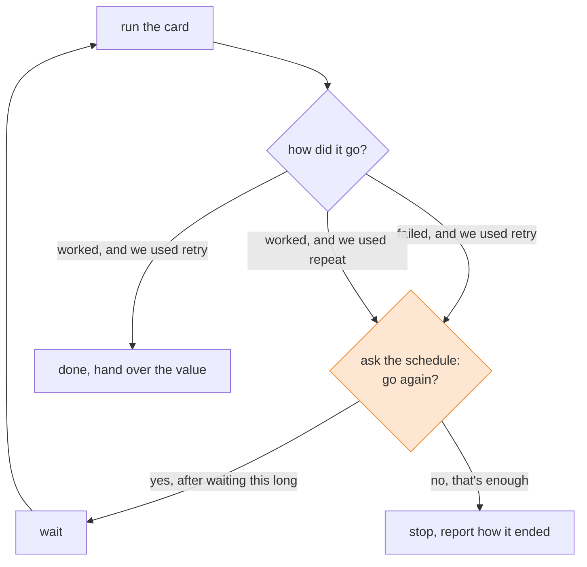

# Lesson 8: The Kitchen Routine

## The big idea

**A schedule is a little plan for *when* to do something again.** It lives on its own, separate
from any recipe card, so you can snap the same schedule onto any card. Snap it on with `retry` to
try again after a failure, or with `repeat` to go again after a success.

## The story

Sam is waiting for a box of mangoes. The truck is late. Sam could stand at the back door and stare
(Lesson 1 says that's a terrible idea), or check the door every two seconds forever, which is
almost as bad.

Ty, the kitchen manager, tapes a chart to the wall:

> **Delivery late?** Check the back door again in 1 minute, then 2, then 4.
> After 3 extra checks, give up and call the farm.
>
> **All shift long:** wipe the counter every 10 minutes.

Look closely at that chart. It doesn't say *how* to check the door or *how* to wipe a counter.
Those are recipe cards Sam already has. The chart only says **when to go again, and when to stop.**
It's a routine, and the kitchen can tape the same routine next to any card.

There are two kinds of "again" on that chart:

1. **Again because it went wrong.** The box wasn't there, so check again later.
   That's `retry`, from Lesson 4.
2. **Again because it went right.** The counter is clean, and in 10 minutes it gets wiped again.
   That's called **repeat**.

The routine chart has a programmer name: a **schedule**.

## The picture



The card does the work. The schedule only answers one question, over and over: *"Again? And how long should I wait first?"*

## The tiniest code

```ts
import { Effect, Console, Schedule, Data } from "effect"

class NotHereYet extends Data.TaggedError("NotHereYet") {}

// Again on SUCCESS: repeat
const wipe = Console.log("🧽 wipe the counter")
const wipeThreeTimes = Effect.repeat(wipe, Schedule.recurs(2))   // 1 + 2 more

// Again on FAILURE: retry
let knocks = 0
const checkDelivery = Effect.gen(function* () {
  knocks++
  if (knocks < 4) {
    yield* Console.log(`knock ${knocks}... not here yet`)
    return yield* Effect.fail(new NotHereYet())
  }
  yield* Console.log(`knock ${knocks}... 📦 here!`)
  return "mangoes"
})
const keepChecking = Effect.retry(checkDelivery, Schedule.spaced("100 millis"))

const program = Effect.gen(function* () {
  yield* wipeThreeTimes
  const box = yield* keepChecking
  yield* Console.log(`got ${box}`)
})

Effect.runPromise(program)
// 🧽 wipe the counter
// 🧽 wipe the counter
// 🧽 wipe the counter
// knock 1... not here yet
// knock 2... not here yet
// knock 3... not here yet
// knock 4... 📦 here!
// got mangoes
```

`Schedule.recurs(2)` means "2 more times." The card always runs once first, so that's 3 wipes.
`Schedule.spaced("100 millis")` means "wait 100 milliseconds, then go again." It has no limit,
so the knocking only stops because the box finally showed up.

## Three rules for the chart

| The chart says | In code | The waits |
|---|---|---|
| "Every 10 minutes" | `Schedule.spaced("10 minutes")` | 10, 10, 10, 10 ... forever |
| "1 minute, then 2, then 4" | `Schedule.exponential("1 minute")` | 1, 2, 4, 8 ... doubling forever |
| "At most 3 more times" | `Schedule.recurs(3)` | no waiting, but stops after 3 |

Notice that the first two never stop on their own. A schedule that says "doubling forever" is a
schedule for a very patient cook.

## Two rules at once

Ty's real chart says *both* "1, then 2, then 4" *and* "give up after 3 extra checks."
You can glue two schedules together with `Schedule.max`:

```ts
const routine = Schedule.max([
  Schedule.exponential("100 millis"),   // wait 100, 200, 400 ...
  Schedule.recurs(3)                    // ...but only 3 more tries
])

const patient = Effect.retry(checkDelivery, routine).pipe(
  Effect.catchTag("NotHereYet", () => Console.log("gave up, call the farm 📞"))
)
// knock at 0 ms... not here yet
// knock at 100 ms... not here yet
// knock at 300 ms... not here yet
// knock at 700 ms... not here yet
// gave up, call the farm 📞
```

(Here the truck never comes, and each knock prints the time.) Read `Schedule.max` as **"follow both
rules."** Sam only goes again if *both* rules say yes, so the moment `recurs(3)` says "that's enough,"
it stops. And when the two rules want different waits, Sam waits the longer one, the *max*.

Look at the gaps: 100, then 200, then 400. That's the doubling. After the last try, the error
`NotHereYet` is still on the card's "Can go wrong" line, because a schedule can give up. So we
wrote a plan for it with `catchTag`, just like Lesson 4.

## Check yourself

1. Sam wipes the counter, and it works. Which one makes Sam wipe again: `retry` or `repeat`?
2. With `Effect.retry(card, Schedule.recurs(3))`, what is the most times the card can run?
3. Why does a kitchen use "wait 1, then 2, then 4" for a late truck instead of "check every second"?
4. A friend writes `Effect.retry(card, Schedule.spaced("1 second"))` and the card fails every
   single time. What happens? How would you fix it?

## Teacher notes

- The key idea is **separation**: the card says *what* to do, the schedule says *when* to do it
  again. Same split as Lesson 3 (plan vs. running). Ask: "Could we tape the delivery chart next
  to a different card, like calling a friend back?" Yes, that's the point.
- `retry` only goes again on **failure**; on success it hands back the value right away.
  `repeat` only goes again on **success**; the first failure stops it and the error comes out.
  `repeat` gives back the schedule's output (for `recurs`, a count), not the card's value.
  Students rarely notice; mention it only if asked.
- "Doubling waits" is called **exponential backoff** by grown-ups. Servers use it so that a
  thousand phones don't all knock at the same second. `Schedule.jittered` adds a little randomness
  for the same reason. Mention it, don't teach it.
- `Schedule.min([a, b])` is the opposite of `max`: keep going while *either* rule says yes, and
  wait the *shorter* gap. Handy for "doubling, but never more than 10 seconds."
- Shortcuts students may see in real code: `Effect.retry(card, { schedule, times: 3 })` and
  `Schedule.upTo({ times: 3 })`, which add a limit without writing `max`. Lesson 4's
  `{ times: 3 }` is the same idea with no waiting between tries.
- Waiting in a schedule is a fiber waiting (Lesson 6). The cook isn't frozen; other bookmarks keep going.
- In Lesson 14 we'll test schedules without actually waiting, by fast-forwarding a pretend clock.
