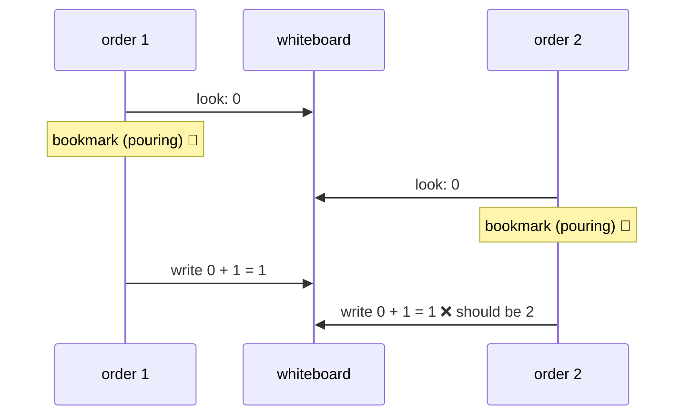

# Lesson 9: The Whiteboard, Shared State

## The big idea

**When several bookmarks share one number, keep it on a whiteboard where "read it, change it, write it
back" is one step nobody can cut into.** Effect calls that whiteboard a **Ref**. It fixes a sneaky bug
where sales go missing even though nobody made a mistake you can see.

## The story

The kitchen has a whiteboard by the door. On it: **Smoothies sold today: 0.** Every time a smoothie goes
out, the tally goes up by one.

Remember Lesson 6: Sam is one cook with several bookmarks. Three orders are in progress. For each one,
Sam does this:

1. Look at the whiteboard. It says **0**. Remember "0."
2. Go pour the smoothie. (This takes a while, so Sam puts a bookmark here and works on another order.)
3. Come back to the whiteboard and write "what I remembered, plus one": **1**.

Watch what happens with three orders. Order 1 looks: 0. Bookmark. Order 2 looks: still 0. Bookmark.
Order 3 looks: still 0. Bookmark. Then all three come back and each one writes **0 + 1 = 1**.

Three smoothies went out. The whiteboard says 1. Two sales vanished, and every single step looked fine.

The problem is the **gap**. Between "look" and "write," Sam put the bookmark down, and the number Sam
remembered went stale. Programmers call this a **lost update**.

The fix: a whiteboard rule. "Read it, add one, write it back" happens **in one step**, with no gap for a
bookmark. Effect's whiteboard is called a **Ref**, and that one step is called `Ref.update`.

Ty, the kitchen manager, has a job here too. Ty checks the label on the whiteboard: "numbers only." Try to
write "banana" on it and Ty stops you before the kitchen opens.

## The picture



The bug lives in the gap between "look" and "write." `Ref.update` has no gap: look, add, and write
are glued into one step, so order 2 always sees order 1's mark.

## The tiniest code

A Ref is made, read, overwritten, and updated. Each of those is a recipe card, so you `yield*` them.

```ts
import { Effect, Console, Ref } from "effect"

const program = Effect.gen(function* () {
  const board = yield* Ref.make(0)          // a whiteboard that says 0

  yield* Ref.set(board, 5)                  // wipe it, write 5
  yield* Ref.update(board, (n) => n + 1)    // read, add 1, write back: one step

  const sold = yield* Ref.get(board)        // look at it
  yield* Console.log(`smoothies sold: ${sold}`)
})

Effect.runPromise(program)
// smoothies sold: 6
```

`board` has the type `Ref<number>`. That's the "numbers only" label Ty checks.

## Watch the sales vanish

Same whiteboard, two ways to sell. The sloppy way reads, pauses, then writes. The safe way uses
`Ref.update`. Three orders run at once, as three fibers.

```ts
import { Effect, Console, Ref } from "effect"

// The sloppy way: read, pause, write back what you remember
const sellSloppy = (board: Ref.Ref<number>) =>
  Effect.gen(function* () {
    const seen = yield* Ref.get(board)      // read the whiteboard
    yield* Effect.sleep("1 second")         // go pour the smoothie 🥤
    yield* Ref.set(board, seen + 1)         // write back: seen + 1
  })

// The safe way: the read-change-write is ONE step
const sellSafe = (board: Ref.Ref<number>) =>
  Effect.gen(function* () {
    yield* Effect.sleep("1 second")         // go pour the smoothie 🥤
    yield* Ref.update(board, (n) => n + 1)  // nobody can cut in
  })

const busyMinute = (sell: (board: Ref.Ref<number>) => Effect.Effect<void>) =>
  Effect.gen(function* () {
    const board = yield* Ref.make(0)        // a fresh whiteboard
    yield* Effect.all(
      [sell(board), sell(board), sell(board)],
      { concurrency: "unbounded" }          // three bookmarks at once
    )
    const sold = yield* Ref.get(board)
    yield* Console.log(`3 smoothies sold, whiteboard says ${sold}`)
  })

Effect.runPromise(
  Effect.gen(function* () {
    yield* busyMinute(sellSloppy)
    yield* busyMinute(sellSafe)
  })
)
// 3 smoothies sold, whiteboard says 1    <-- lost two sales!
// 3 smoothies sold, whiteboard says 3    <-- correct
```

Notice: the sloppy way **also uses a Ref**. A Ref doesn't save you if you split "read" and "write" into
two steps with a pause between them. The magic is in `Ref.update`, which never leaves a gap.

## A fresh whiteboard every run

`Ref.make(0)` is a recipe card too: "get a new whiteboard that says 0." So every time you run a recipe
that makes one, you get a **brand new** whiteboard. In the code above, `busyMinute` runs twice and the
second run starts at 0, not at 1. Monday's tally doesn't leak into Tuesday.

## Check yourself

1. Three smoothies went out, and the whiteboard says 1. In kitchen words, what went wrong?
2. JavaScript has one cook. So how can two orders "cut in" on each other at all?
3. Why does the sloppy seller lose sales even though it uses a Ref?
4. You run a recipe that starts with `Ref.make(0)` two times. Does the second run start at 0, or where
   the first run left off? Why?

## Teacher notes

- Answers: (1) Each order remembered an old number during the pause and wrote it back, erasing the
  others. (2) Bookmarks: Sam puts one order down during the pause and picks up another, so the gap is
  real even with one cook. (3) It reads with `Ref.get`, pauses, then writes with `Ref.set`; the gap is
  still there. (4) At 0. `Ref.make` is a card, so each run makes a new whiteboard.
- **Be honest about one cook.** A plain `count++` in JavaScript is never torn in half. The bug only appears
  when a recipe reads, then pauses (`yield*` of a sleep, an `await`, a network call), then writes back. A
  sharp kid may notice that removing the `sleep` from `sellSloppy` gives 3. True today, but don't rely on
  it: Effect may also switch fibers between any two `yield*` steps to be fair. `Ref.update` is the
  guarantee.
- Grown-up terms: this is a **race condition**, specifically a **lost update** or "read-modify-write"
  bug. A Ref is a mutable reference whose updates are **atomic** (all at once, never half done).
- `Ref.updateAndGet(board, f)` updates and hands back the new number in the same step. `Ref.modify` updates
  *and* returns something else, like a ticket number: `Ref.modify(board, (n) => [n + 1, n + 1])`. Mention,
  don't teach.
- `SynchronizedRef` is for when the update itself is a card (it needs to wait, like asking the fridge
  first): `SynchronizedRef.updateEffect`. Other updaters wait in line while it runs. `SubscriptionRef` is a
  whiteboard you can *watch*: it gives a stream of every new value (Stream is Lesson 11).
- "Why not just a global `let count = 0`?" Three reasons: it is shared by every run of the program
  (no fresh whiteboard, so tests leak into each other); it doesn't show up in any type; and it has the
  same lost-update gap anyway. A Ref is made inside the recipe and passed where it's needed.
- Lesson 10 (Queues) is the next step: instead of everyone writing on one board, orders are passed from
  one bookmark to another on a shelf.
