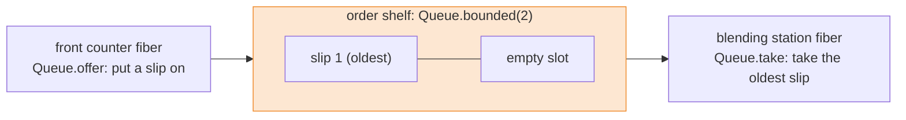

# Lesson 10: The Order Shelf, Queues

## The big idea

**A queue is a shelf between two fibers: one side puts orders on, the other side takes them off, in order.**
Whoever finds the shelf empty, or full, waits. And waiting is a bookmark, not a frozen kitchen.

## The story

Lunch rush. Maya and eleven friends line up at the counter.

Taking an order is quick: ten seconds. Making a smoothie is slow: a whole minute in the blender.
If Sam takes Maya's order and then blends it before taking the next one, the whole line stands
still for a minute per person. Nobody likes that kitchen.

So Sam puts a **shelf** between the front counter and the blending station. The front counter
writes an order slip and puts it on the shelf. The blending station takes the *oldest* slip off
the shelf and makes that smoothie. First on, first off, like a line at the bus stop.

Remember Lesson 6: still one cook. The front counter is one recipe with a bookmark, the
blending station is another. Sam hops between them whenever one of them has to wait.

Two kinds of waiting can happen:

- **The shelf is empty.** The blending station has nothing to do. It puts in a bookmark and
  waits for a slip. Sam goes and takes orders meanwhile. Nothing freezes.
- **The shelf is full.** It only has two slots. The front counter says "one second, please" and
  waits until the blending station takes a slip off. Then the next slip goes on.

That second kind is important. The full shelf *pushes back* on the front counter, so the kitchen
never ends up with 500 slips and 3 bananas. Programmers call that push **backpressure**.

Programmers call the shelf itself a **queue**. Ty, the kitchen manager, checks what goes on it:
if it's an order shelf, only order slips go on. Try to put a shoe there and Ty stops you before
the kitchen opens.

## The picture



Slips go in one end and come out the other, in the same order. Shelf full? The counter waits.
Shelf empty? The blender waits.

## The tiniest code

```ts
import { Effect, Queue, Console, Fiber } from "effect"

const program = Effect.gen(function* () {
  const shelf = yield* Queue.bounded<string>(2)   // a shelf with 2 slots

  const cashier = Effect.gen(function* () {
    for (const order of ["mango", "berry", "kiwi", "lime"]) {
      yield* Queue.offer(shelf, order)             // put (waits if full)
      yield* Console.log(`cashier: ${order} is on the shelf`)
    }
  })

  const blender = Effect.gen(function* () {
    for (let i = 0; i < 4; i++) {
      const order = yield* Queue.take(shelf)       // take (waits if empty)
      yield* Effect.sleep("1 second")              // blending takes a while
      yield* Console.log(`blender: ${order} smoothie 🥤`)
    }
  })

  const front = yield* Effect.forkChild(cashier)   // bookmark 1
  const back = yield* Effect.forkChild(blender)    // bookmark 2
  yield* Fiber.join(front)
  yield* Fiber.join(back)
})

Effect.runPromise(program)
// cashier: mango is on the shelf
// cashier: berry is on the shelf
// cashier: kiwi is on the shelf
// blender: mango smoothie 🥤
// cashier: lime is on the shelf     <-- waited a whole second for a free slot
// blender: berry smoothie 🥤
// blender: kiwi smoothie 🥤
// blender: lime smoothie 🥤
```

Read the log slowly. Mango and berry fill both slots. Kiwi gets on because the blender already
grabbed mango off the shelf and into the jar. Then the shelf is full again, so lime waits, the
cashier's bookmark stays put, until mango is done and the blender takes berry.

The recipe-card lines still work. `Queue.bounded<string>(2)` is a card that **gives you** a shelf
for strings. `Queue.take(shelf)` is a card that **gives you** a string. Neither has anything on the
"can go wrong" line.

## Two blenders, one shelf

Add a second blending station. Both take from the same shelf, and each slip goes to exactly one
of them, never both.

```ts
const blender = (name: string) =>
  Effect.gen(function* () {
    for (let i = 0; i < 2; i++) {
      const order = yield* Queue.take(shelf)
      yield* Effect.sleep("1 second")
      yield* Console.log(`${name}: ${order} smoothie 🥤`)
    }
  })

const left = yield* Effect.forkChild(blender("left blender"))
const right = yield* Effect.forkChild(blender("right blender"))
// ...cashier forked and every fiber joined, same as before
// left blender: mango smoothie 🥤
// right blender: berry smoothie 🥤
// left blender: kiwi smoothie 🥤
// right blender: lime smoothie 🥤
```

Four smoothies in about two seconds instead of four. Still one cook: the *blenders* do the
waiting, and Sam just keeps two bookmarks open.

## Check yourself

1. The blending station finds the shelf empty. What does it do? Does the rest of the kitchen freeze?
2. The shelf has 2 slots, but the log shows three orders on the shelf before the first smoothie. How?
3. What is backpressure, in kitchen words? Why is it a *good* thing that the cashier has to wait?
4. With two blenders and four one-second orders, how long does it take? Did we add a second cook?

## Teacher notes

- Grown-up words: the cashier is the **producer**, the blender is the **consumer**, and "first on,
  first off" is **FIFO** (first in, first out). Use them after the picture lands, not before.
- Other shelf shapes, worth a mention: `Queue.unbounded()` has no limit, so `offer` never waits
  (and the slips can pile up forever). `Queue.sliding(n)`: when full, the new slip goes on and the
  *oldest* falls off. `Queue.dropping(n)`: when full, the *new* slip is thrown away. In those two,
  `offer` hands back `false` when a slip didn't make it.
- Why the loops count to 4: a real kitchen loops forever (`Effect.forever`) and stops by
  interruption (Lesson 6) or by closing the shelf. Closing: make it with
  `Queue.bounded<string, Cause.Done>(n)` and call `Queue.end(shelf)`. Slips already on the shelf can
  still be taken, then `take` fails with `Done`. That's what the queue's second type slot is for.
  `Queue.shutdown` is the rude version: it throws away whatever is left.
- If a kid asks "can everyone hear every order?": that's `PubSub`, the **loudspeaker**. Each
  listener calls `PubSub.subscribe` (it needs a Scope, Lesson 7) and every listener gets every
  message from `PubSub.publish`. A queue hands each slip to exactly one taker.
- `Deferred` is the pickup bell: a one-time slot that is filled once (`Deferred.succeed`) and
  wakes everyone waiting on `Deferred.await`. Nice for "start when the kitchen opens."
- Contrast with Lesson 9: the whiteboard (`Ref`) holds *one* current value anyone can read again.
  The shelf holds a *line* of things, and taking one removes it. Lesson 11's conveyor belt can be
  fed straight from a queue (`Stream.fromQueue`).
