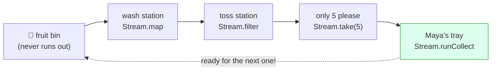

# Lesson 11: The Conveyor Belt, Streams

## The big idea

**A recipe card hands you one thing. A stream hands you many things, one after another, maybe
forever.** And a stream is still a plan: nothing moves until you run it.

## The story

Sam's kitchen gets a new toy: a sushi-style conveyor belt. Fruit rides along it, one piece at a time.

Along the belt are little stations:

1. **The wash station** sprays every fruit. A mango goes in, a clean mango comes out.
2. **The toss station** looks at each fruit. Bruised ones get tossed in the bin. Good ones ride on.
3. **The counter station** has a sign: "only the first 5, please." After five, it says "stop."

At the very end stands Maya with a tray. Here's the clever part: **the belt only moves when Maya is
ready for the next piece.** She reaches out, the belt clicks forward, one fruit arrives. She doesn't
reach, nothing moves. When the counter station says "that's 5," the belt stops for good, even though
the fruit bin behind it never runs out.

Programmers call a belt like this a **stream**. Because the person at the end does the reaching, they say
it is **pull-based**: the end *pulls* fruit, the belt doesn't shove it.

## The picture



Fruit moves left to right. The *asking* moves right to left (the dotted arrow). No ask, no move.

## The tiniest code

```ts
import { Console, Effect, Stream } from "effect"

const belt = Stream.make("🥭", "🍓", "🍌", "🥝")   // four fruit on the belt
// belt : Stream<string, never, never>

const washed = belt.pipe(
  Stream.map((fruit) => fruit + "💧")               // the wash station
)

const program = Effect.gen(function* () {
  const tray = yield* Stream.runCollect(washed)     // run the belt, keep everything
  yield* Console.log(tray)
})

Effect.runPromise(program)
// [ '🥭💧', '🍓💧', '🍌💧', '🥝💧' ]
```

`Stream.make` puts fruit on the belt. Have an array already? `Stream.fromIterable(["🥭", "🍓"])` does
the same. `.pipe(...)` adds stations, in order. `Stream.runCollect` is Maya with a tray: she runs the
belt to the end and hands back an array of everything that arrived.

## The same three lines

Look at that type: `Stream<string, never, never>`. Three slots, the same three lines as a recipe card
(Lesson 3):

| Line | On a card `Effect<A, E, R>` | On a belt `Stream<A, E, R>` |
|---|---|---|
| You get | one `A` | many `A`s, one at a time |
| Can go wrong | `E` | `E` (a fruit falls off and the belt stops) |
| Needs | `R` | `R` (services, like Lesson 5) |

And running it turns the belt back into a card: `Stream.runCollect(washed)` is an
`Effect<Array<string>, never, never>`. You `yield*` it like any other card.

## An endless belt

Now a fruit bin that *never* runs out. We add a little window, `Stream.tap`, so we can watch every
time the belt moves.

```ts
const endlessBelt = Stream.iterate(1, (n) => n + 1)   // fruit #1, #2, #3, ... forever

const firstFive = endlessBelt.pipe(
  Stream.tap((n) => Console.log(`belt moves: fruit #${n}`)),  // a window to watch the belt
  Stream.filter((n) => n % 3 !== 0),          // toss station: every 3rd fruit is bruised
  Stream.map((n) => `  washed fruit #${n} 💧`), // wash station
  Stream.take(5)                              // "only the first 5, please"
)

const program = Effect.gen(function* () {
  yield* Stream.runForEach(firstFive, (fruit) => Console.log(fruit))
  yield* Console.log("belt stopped. done! 🎉")
})

Effect.runPromise(program)
// belt moves: fruit #1
//   washed fruit #1 💧
// belt moves: fruit #2
//   washed fruit #2 💧
// belt moves: fruit #3        <-- bruised, tossed
// belt moves: fruit #4
//   washed fruit #4 💧
// belt moves: fruit #5
//   washed fruit #5 💧
// belt moves: fruit #6        <-- bruised, tossed
// belt moves: fruit #7
//   washed fruit #7 💧
// belt stopped. done! 🎉
```

An endless belt, and the program **finishes**. Count the "belt moves" lines: seven. Fruit #8 never
moves, because nobody asked for it. That's pull-based. `Stream.runForEach` is a different Maya: instead
of filling a tray, she does something with each fruit as it arrives.

Try the same thing with a plain array and you'd have to build the whole endless array first. You'd be
waiting forever.

## Check yourself

1. An Effect hands you one thing. What does a stream hand you?
2. Which station tosses bruised fruit, `map` or `filter`? Which one washes?
3. The belt is endless, but the program above stops. Why? How many fruit actually moved?
4. You write `const belt = Stream.make("🥭", "🍓")` and nothing prints, nothing moves. Is that a bug?

## Teacher notes

- Answers: (1) many things, one after another, maybe forever. (2) `filter` tosses, `map` washes.
  (3) `take(5)` stops asking after five, and nothing upstream moves without being asked; 7 moved.
  (4) No. A stream is a plan, like a card. Nothing moves until a `run...` function runs it.
- "Pull-based" vs "push-based": a Promise or an event listener *pushes* values at you whether you're
  ready or not. A pull-based stream waits for the consumer. That's also how backpressure from Lesson 10
  shows up here: a slow Maya just means a slow belt, never a pile of fruit on the floor.
- A sharp kid may ask "is it really one fruit at a time?" Honest answer: under the hood Effect moves
  fruit in small batches (it calls them **chunks**) to be fast. The rules still behave like one at a
  time: `take(5)` gives exactly five, and an endless belt still stops.
- Other ways to build a belt: `Stream.range(1, 10)`, `Stream.tick("1 second")` (an endless belt that
  clicks once a second), `Stream.fromSchedule(...)` using the schedules from Lesson 8,
  `Stream.fromEffectSchedule(card, schedule)` for "check the oven every 30 seconds."
- `Stream.mapEffect(f, { concurrency: 4 })` is a station that runs a whole recipe card per fruit,
  several at once (Lesson 6's bookmarks, still one cook).
- `Stream.fromQueue(shelf)` turns Lesson 10's order shelf into a belt: whatever lands on the shelf
  rides the belt. `Stream.fromPubSub` does the same for a PubSub.
- A **Sink** is the grown-up word for "whoever is at the end of the belt." `Stream.run(stream, Sink.sum)`
  adds up numbers. `runCollect`, `runForEach`, `runFold`, `runDrain` are the common ones.
- Async iterables (`for await`) are JavaScript's built-in belt. `Stream.fromAsyncIterable` and
  `Stream.toAsyncIterable` convert both ways.
- In v4, `runCollect` gives a plain `Array`. Older Effect (v2/v3) gave a `Chunk`, so old blog posts may
  look different.
