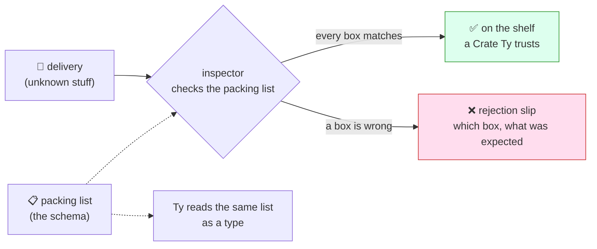

# Lesson 12: Checking the Delivery

## The big idea

**Anything that comes from outside the kitchen gets checked at the back door.** Effect lets you write
down what a delivery *should* look like, once. That one description does two jobs: it checks the real
delivery while the kitchen is running, and it tells Ty what a good delivery looks like.

## The story

Every morning a truck pulls up to the back door with crates of fruit. Sam didn't pack those crates.
Sam has never met the driver. Maybe the crate says "mango" and it's full of bananas. Maybe it says
"12" and it's empty.

Ty can't help here. Ty checks the recipe cards *before* the kitchen opens (Lesson 3). The truck
arrives *after*, while the kitchen is running. Ty never sees what's inside the crates.

So the kitchen keeps a **packing list** taped by the back door:

> Crate of fruit. **fruit:** the word "mango" or the word "berry". **count:** a whole number above 0.

An inspector stands at the door and checks each box on the list against the real crate. If
everything matches, the crate goes on the shelf, and from then on everyone can trust it. If anything
is wrong, the crate stays on the truck with a **rejection slip** that says exactly which box was wrong:
"fruit: expected mango or berry."

Programmers call that packing list a **schema**. Checking a delivery against it is called **decoding**.

## The picture



One packing list. The inspector uses it at the door; Ty uses it to check the cards.

## The tiniest code

```ts
import { Effect, Console, Schema } from "effect"

// The packing list: what a crate of fruit SHOULD look like.
const Crate = Schema.Struct({
  fruit: Schema.Literals(["mango", "berry"]),     // the word "mango" or the word "berry"
  count: Schema.Int.check(Schema.isGreaterThan(0)) // a whole number above 0
})

// Same description, second job: a type Ty can read.
type Crate = typeof Crate.Type
// { readonly fruit: "mango" | "berry"; readonly count: number }

// The inspector at the back door.
const inspect = Schema.decodeUnknownEffect(Crate)
// inspect : (delivery: unknown) => Effect<Crate, SchemaError>

const backDoor = (delivery: unknown) =>
  Effect.gen(function* () {
    const crate = yield* inspect(delivery)        // check every box first
    yield* Console.log(`✅ on the shelf: ${crate.count} ${crate.fruit}`)
  }).pipe(
    Effect.catchTag("SchemaError", (err) => Console.log(`❌ rejected: ${err.message}`))
  )

const morning = Effect.gen(function* () {
  yield* backDoor({ fruit: "mango", count: 12 })
  yield* backDoor({ fruit: "banana", count: 12 })
  yield* backDoor(JSON.parse('{ "fruit": "berry", "count": 0 }'))
})

Effect.runPromise(morning)
// ✅ on the shelf: 12 mango
// ❌ rejected: Expected "mango" | "berry"
//   at ["fruit"]
// ❌ rejected: Expected a value greater than 0
//   at ["count"]
```

Read the inspector's card out loud: "You get: a Crate. Can go wrong: SchemaError. Needs: nothing."
It's a recipe card like any other, so `Effect.catchTag` from Lesson 4 works on it. `unknown` is
TypeScript's word for "a sealed box, nobody knows what's inside." The inspector is the only one
allowed to open it.

## What Ty sees

Once a crate is past the door, Ty knows its exact shape and helps you again:

```ts
const crate = yield* inspect(delivery)
crate.count + 1              // fine: Ty knows count is a number
crate.colour                 // ❌ Ty: there is no "colour" on the packing list
crate.fruit === "kiwi"       // ❌ Ty: fruit can only be "mango" or "berry"
```

You never wrote `type Crate = { ... }` by hand. It came from the packing list, so the check and the
type can't drift apart.

## The rejection slip

By default the inspector stops at the first wrong box. Ask for `{ errors: "all" }` to get every one:

```ts
Effect.runPromise(
  inspect({ fruit: "kiwi", count: 2.5 }, { errors: "all" }).pipe(
    Effect.catchTag("SchemaError", (err) => Console.log(`❌ ${err.message}`))
  )
)
// ❌ Expected "mango" | "berry"
//   at ["fruit"]
// Expected an integer
//   at ["count"]
```

Each line says what was expected, then `at` says which box. That's the whole slip.

## Check yourself

1. Why can't Ty check the delivery trucks the way Ty checks recipe cards?
2. Name the two jobs one packing list does.
3. A delivery arrives as `{ fruit: "mango", count: "12" }`. Does it go on the shelf? Which box is wrong?
4. What's on the "Can go wrong" line of `inspect(delivery)`, and how do you cross it off?

## Teacher notes

- **Decoding** is outside to inside. **Encoding** is the reverse trip, inside to outside, for when
  you send data away (save a file, answer a web request). `Schema.encodeEffect(Crate)` does it. For
  this schema both sides look the same; they differ once a schema transforms data, like turning the
  text `"2026-10-11"` into a real date. Mention, don't teach.
- `Schema.Struct` builds a plain object. `Schema.Class` builds a class from the same field list, for
  when you want methods on your crates. Same checking, different container.
- `Schema.TaggedError` is the schema-backed cousin of Lesson 4's `Data.TaggedError`: same `_tag`,
  same `catchTag`, but the error itself has a packing list, so it can be safely sent over a network
  and checked on the other side. Effect's own guides recommend it for errors in real apps.
- Extra boxes that aren't on the list are quietly dropped from the result by default. Pass
  `{ onExcessProperty: "error" }` to reject them instead.
- `Schema.fromJsonString(Crate)` checks raw JSON text in one step, including "that wasn't JSON at all"
  (`Expected a valid JSON string`). `Schema.decodeUnknownSync` is the version that throws instead of
  returning a recipe card; it's for the edges of a program, like `runPromise`.
- The slip doesn't repeat the bad value by default, on purpose: deliveries can contain passwords.
- Kids may have heard of **zod** or **valibot**. Same idea, different libraries. Many of them, Effect
  Schema included, speak a shared format called Standard Schema (`Schema.toStandardSchemaV1`), so
  form libraries can use any of them.
- Grown-up words: this is **validation** or **parsing** at a **trust boundary**. "The back door" is fine.
