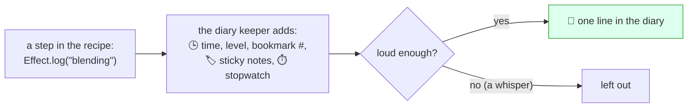

# Lesson 13: The Kitchen Diary

## The big idea

**A busy kitchen keeps a diary, so that tomorrow you can find out what happened today.** Effect's
diary lines already know *when* they were written and *which* bookmark wrote them. They can carry a
sticky note (order #42) on every line, and they can time each step with a stopwatch.

## The story

Maya is back at the counter. "Yesterday my smoothie took forever. What happened?"

Sam shrugs. Sam made thirty smoothies yesterday, with lots of bookmarks in lots of recipes (Lesson 6).
Nobody remembers order #42.

So the kitchen starts a **diary**: a clipboard by the door. Every time something happens, one line
goes in it: the time, how serious it is ("just a note," "watch out," "problem!"), and which bookmark
was being worked on. While Sam cooks order #42, a yellow sticky note that says "order #42" goes on
every line about it. And when the blender runs, Sam clicks a stopwatch.

A week later, Maya's smoothie is slow again. This time Sam flips to the lines with Maya's sticky note:
`WARN blender jammed, blend=4 minutes`. Mystery solved.

Programmers call the diary a **log**. Writing one line is **logging**. (Ty can't help here. Ty checks
recipe cards *before* cooking. The diary is about what happened *while* cooking.)

## The picture



You only write the message. Effect fills in everything else.

## The tiniest code

```ts
import { Effect } from "effect"

const smoothie = Effect.gen(function* () {
  yield* Effect.log("order received")
  yield* Effect.logWarning("only 2 mangoes left")
  yield* Effect.logError("blender jammed!")
})

Effect.runPromise(smoothie)
// something like:
// [16:20:01.042] INFO (#1): order received
// [16:20:01.043] WARN (#1): only 2 mangoes left
// [16:20:01.043] ERROR (#1): blender jammed!
```

Read one line left to right: **the time** (hours, minutes, seconds, thousandths), **the level**
(how serious), **the bookmark** (`#1` is the fiber that wrote it), and then **your message**. Your
times and numbers will be different. The shape will be the same.

`Effect.log` is a recipe card too, `Effect<void>`: nothing can go wrong, needs nothing. It only
writes when the recipe runs.

## Whisper or shout

Some lines are whispers, some are shouts. The levels, quietest to loudest:
**Debug** (whisper), **Info** (normal voice), **Warn** (watch out), **Error** (problem!).

`Effect.logDebug("checking the fridge")` is a whisper: it is left out unless you ask for it. You can
also turn the volume knob the other way, so only warnings and louder get written. The kitchen
supplies that setting, just like it supplied the blender in Lesson 5. Same `smoothie` as above:

```ts
import { References } from "effect"

Effect.runPromise(
  smoothie.pipe(Effect.provideService(References.MinimumLogLevel, "Warn"))
)
// something like:
// [16:20:01.043] WARN (#1): only 2 mangoes left
// [16:20:01.043] ERROR (#1): blender jammed!
```

The recipe did not change. Only the knob did.

## Sticky notes and stopwatches

Two orders at once, two bookmarks. First, the sticky note. `Effect.annotateLogs` sticks it on
*every* line inside, so you don't have to type "order 42" over and over:

```ts
const makeSmoothie = (order: number) =>
  Effect.gen(function* () {
    yield* Effect.log("blending")
    yield* Effect.sleep("100 millis")
    yield* Effect.log("poured 🥤")
  }).pipe(Effect.annotateLogs({ order }))   // 🏷️ sticky note on every line

Effect.runPromise(
  Effect.all([makeSmoothie(41), makeSmoothie(42)], { concurrency: 2 })
)
// something like:
// [16:20:01.042] INFO (#2): blending { order: 41 }
// [16:20:01.043] INFO (#3): blending { order: 42 }
// [16:20:01.144] INFO (#2): poured 🥤 { order: 41 }
// [16:20:01.144] INFO (#3): poured 🥤 { order: 42 }
```

Bookmark `#2` cooked order 41 and bookmark `#3` cooked order 42. The lines are mixed together, but
the sticky notes sort them out.

Now the stopwatch. `Effect.withLogSpan("blend")` starts one when the step begins, and every line
inside says how long it has been running:

```ts
const blend = Effect.gen(function* () {
  yield* Effect.log("blender on")
  yield* Effect.sleep("120 millis")
  yield* Effect.log("blender off")
}).pipe(Effect.withLogSpan("blend"))        // ⏱️ start the stopwatch

Effect.runPromise(blend)
// something like:
// [16:20:01.042] INFO (#1) blend=1ms: blender on
// [16:20:01.164] INFO (#1) blend=122ms: blender off
```

## Spans: drawing the timeline

A diary is words. Sometimes you want a *picture* of the day: a bar for each step, showing when it
started and how long it took, with smaller steps tucked under bigger ones. Programmers call one bar a
**span**, and the whole picture a **trace**.

```ts
const blend = Effect.sleep("100 millis").pipe(Effect.withSpan("blend"))
const pour  = Effect.sleep("20 millis").pipe(Effect.withSpan("pour"))

const makeSmoothie = Effect.fn("makeSmoothie")(function* (order: number) {
  yield* blend
  yield* pour
  return `🥤 for order ${order}`
})

Effect.runPromise(makeSmoothie(42)).then(console.log)
// 🥤 for order 42
// (no extra lines print: the spans are for a tracing tool to draw)
```

`Effect.withSpan("blend")` names one step. `Effect.fn("makeSmoothie")` is a recipe that takes
ingredients (here, the order number) and gets a name tag, which makes a span too. Hook up a tracing
tool and it draws:

```
makeSmoothie  ██████████████████████████  120ms
  blend       █████████████████████        100ms
  pour                             █████    20ms
```

## Check yourself

1. Name three parts of a log line that Effect fills in for you.
2. Your diary is too noisy. Do you change the recipe, or turn the knob? Which knob?
3. Two smoothies are being made at once and their lines are mixed up. What tells them apart?
4. What's the difference between `withLogSpan` (stopwatch) and `withSpan` (a bar on the timeline)?

## Teacher notes

- Answers: (1) time, level, bookmark number (plus sticky notes and stopwatch, if you asked for them).
  (2) The knob: `References.MinimumLogLevel`. (3) The bookmark number and the sticky note.
  (4) `withLogSpan` puts a time *inside diary lines*; `withSpan` makes a bar for a tracing tool.
- *"Why not just `console.log`?"* `console.log` has no time, no level, no bookmark, no sticky notes,
  and you can't turn it down without deleting lines. Unit 1 used `Console.log` for plain output, and
  that's still fine for "here is my answer." `Effect.log` is for "here is what happened."
- Also: `Effect.logFatal` (louder than Error), `Effect.logTrace` (quieter than Debug). `Effect.log`
  is Info level. `Effect.log("blending", order)` takes several values, like `console.log`, but sticky
  notes are better for things you want to search by later.
- The default format is for people. Real apps often switch to one JSON object per line,
  `Logger.layer([Logger.consoleJson])`, so machines can search the diary. Mention, don't teach.
- Tracing tools speak a shared language called OpenTelemetry. Effect ships exporters in
  `effect/observability` (`OtlpTracer`, `OtlpLogger`). Setting one up needs a running collector;
  not worth class time. Say "the bars get sent to a tool that draws them."
- Effect also has **metrics** (`Metric.counter`, `Metric.histogram`): numbers like "smoothies made
  today." Diary = what happened, timeline = how long, metrics = how many.
- Fiber numbers like `#2` depend on how many fibers ran before, so never test against them. Lesson 14
  tests behavior, not diary formatting.
