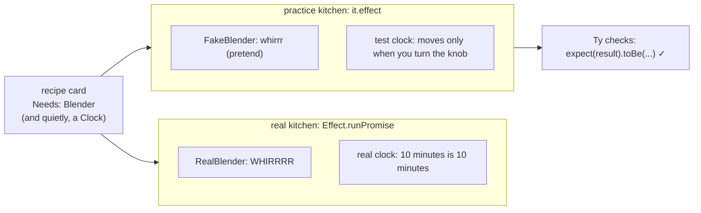

# Lesson 14: The Practice Kitchen

## The big idea

**A recipe card only *asks* for its appliances and its clock, so you can run it in a practice kitchen
with pretend ones.** In the practice kitchen the blender is pretend and the wall clock only moves when
you turn its knob. A test of "wait 10 minutes, then try again" finishes in a blink.

## The story

Back in Lesson 5, Sam learned recipes in a practice kitchen. The blender there was pretend: it said
"whirrr" and handed back a smoothie right away. No mess, no real mangoes.

Now the practice kitchen gets one more strange thing: **a magic wall clock.** Its hands do not move
on their own. They only move when the teacher turns a knob on the side.

Why would anyone want that? Look at Lesson 8's routine: "No mango? Check the fridge again every
5 minutes." To practice that with a real clock, Sam would stand around for 10 minutes. With the magic
clock, the teacher turns the knob, *click, click*, and 10 minutes pass in no time at all.

Ty, the kitchen manager, watches each practice run with a clipboard. At the end he checks the result
against what it should be: thumbs up or thumbs down. Programmers call a practice run with a checklist a
**test**. The magic clock has a name too: the **test clock**.

## The picture



Same card, two kitchens. The card never knows which one it's in.

## The tiniest code

Step 1: install the practice kitchen once, in your class folder.

```bash
npm install -D vitest @effect/vitest
```

Step 2: make a file whose name ends in `.test.ts`, like `kitchen.test.ts`. Bring back Lesson 5's
`Blender`, `smoothie`, and `FakeBlender`, then write a test:

```ts
import { it, expect } from "@effect/vitest"
import { Effect } from "effect"

it.effect("makes a smoothie with a pretend blender", () =>
  Effect.gen(function* () {
    const drink = yield* smoothie.pipe(Effect.provide(FakeBlender))
    expect(drink).toBe("🥤 (pretend)")
  }))
```

Read it as: "**It** makes a smoothie with a pretend blender. Run this recipe in the practice kitchen.
**Expect** the drink **to be** a pretend smoothie." `expect` is Ty with his clipboard.

Step 3: a test that needs the magic clock.

```ts
import { Fiber } from "effect"
import { TestClock } from "effect/testing"

it.effect("the toast is ready after 10 minutes", () =>
  Effect.gen(function* () {
    const toast = Effect.sleep("10 minutes").pipe(Effect.as("🍞"))

    const bookmark = yield* Effect.forkChild(toast)   // start it, keep a bookmark
    yield* TestClock.adjust("10 minutes")             // turn the knob
    const result = yield* Fiber.join(bookmark)        // wait for the bookmark

    expect(result).toBe("🍞")
  }))
```

Why the bookmark (Lesson 6)? If Sam just slept on the toast, *he* would be the one stuck waiting, and
nobody would be left to turn the knob. So he starts the toast on a bookmark, turns the knob himself,
then picks the bookmark back up.

Step 4: run it.

```
npx vitest run
 Test Files  1 passed (1)
      Tests  3 passed (3)
   Duration  313ms
```

Three tests (the third one is below), and the whole run took about a third of a second, even though
the recipes "waited" 20 minutes.

## Fast-forwarding Lesson 8's routine

Here is a fridge check that fails twice, then finds a mango. Lesson 8's routine says: try again every
5 minutes.

```ts
import { Data, Schedule } from "effect"

class NoMango extends Data.TaggedError("NoMango") {}

it.effect("the fridge check retries every 5 minutes", () =>
  Effect.gen(function* () {
    let tries = 0
    const checkFridge = Effect.gen(function* () {
      tries = tries + 1
      if (tries < 3) return yield* Effect.fail(new NoMango())
      return "🥭"
    })

    const patient = checkFridge.pipe(Effect.retry(Schedule.spaced("5 minutes")))
    const bookmark = yield* Effect.forkChild(patient)

    yield* TestClock.adjust("5 minutes")
    expect(tries).toBe(2)                     // second try, still no mango

    yield* TestClock.adjust("5 minutes")
    const fruit = yield* Fiber.join(bookmark)
    expect(fruit).toBe("🥭")                  // third try worked
    expect(tries).toBe(3)
  }))
```

Each turn of the knob lets exactly one more try happen. You can stop between turns and check on
things, like freezing a video to look at one frame.

## Why the clock can be magic

`Effect.sleep` and every schedule from Lesson 8 never look at the wall themselves. They *ask Effect's
clock* what time it is. The clock is an appliance, just like the blender. The kitchen always has one,
so it doesn't show up on the "Needs" line, but the recipe still asks for it.

`Effect.runPromise` hands out the real clock. `it.effect` hands out the test clock. That's the whole
trick, and it's the same trick as Lesson 5: **the recipe asks, the kitchen provides.**

## Check yourself

1. In the practice kitchen, what's pretend? Name two things.
2. Why does the toast test start the toast on a bookmark (`Effect.forkChild`) before turning the knob?
3. The retry test "waits" 10 minutes. About how long does it really take to run? Why?
4. A friend's recipe calls JavaScript's own `setTimeout` instead of `Effect.sleep`. Will
   `TestClock.adjust` speed it up? Why or why not?

## Teacher notes

- Answers: (1) the blender and the clock; (2) if the test itself slept, nothing would be left to turn
  the knob; (3) a few milliseconds, because the test clock jumps instead of ticking; (4) no, `setTimeout`
  never asks Effect's clock, so the knob can't reach it.
- If a student forgets `TestClock.adjust`, the test doesn't fail right away. It sits waiting on a clock
  that never moves until vitest gives up ("Test timed out in 5000ms"). That's a great bug to make on purpose.
- `it.live("name", () => ...)` is the same as `it.effect` but uses the real clock. Mention it for things
  that truly need real time; most tests shouldn't.
- `layer(FakeBlender)("practice kitchen", (it) => { ... })` from `@effect/vitest` gives every test inside
  the block the same pretend blender, built once. Mention it, don't teach it.
- `expect` comes from vitest itself; `@effect/vitest` passes it along. `assert.strictEqual(a, b)` works
  too, and you'll see it in Effect's own examples.
- This is *why* services exist. A recipe that builds its own blender, or reads the real clock, can only
  be practiced in the real kitchen. Asking instead of grabbing is what makes recipes testable.
- Grown-up terms: a pretend service is a **test double** (or "fake"); the magic clock is **virtual time**.
- Setup: in the class folder, `npm install -D vitest @effect/vitest`, name files `*.test.ts`, run
  `npx vitest run` (or `npx vitest` to re-run on every save). No config file is needed.
- Capstone idea: give students their smoothie shop from Unit 1 and ask for three tests: the happy
  path with a pretend blender, the "out of mango" path, and a retry that needs the knob turned twice.
